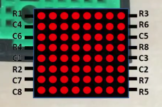

# ESP32 Web UI Based 8×8 LED Matrix Controller

Drives a bare 8×8 LED matrix **directly from an ESP32** (no MAX7219 or other driver IC) and control it from your phone over WiFi. The ESP32 creates its own access point and serves a touch-friendly pixel editor and animation player.

## Features

- **Direct multiplexed drive**: timer-based scanner (`esp_timer`, 150 µs tick) refreshes the matrix at ~104 Hz with no flicker while WiFi is busy
- **Self-hosted WiFi AP**: no router needed, just connect and open `http://192.168.4.1`
- **Mobile web UI** (embedded in firmware): tap/drag pixel editor, up to 64 animation frames, speed and brightness sliders
- **Live mode**: edits appear on the real matrix as you draw
- **Preview**: play the animation in the browser before sending
- **Built-in patterns**: Heart, Smiley, Checker, Scan, Rain, Ripple, Spiral
- **Edit tools**: clear, invert, shift ↑ ↓ ← →, duplicate/delete frames, mirror and flip output
- **Password-protected WebSocket** control channel
- **IP scroller**: while no client is connected, the matrix scrolls the AP's IP address

## Hardware

| Part | Notes |
|---|---|
| ESP32 dev board | Any ESP32 with the GPIOs below exposed |
| 8×8 LED matrix (common 16-pin, e.g. 1088AS/788BS style) | See pinout below |
| 8× NPN transistors | Switch the row lines (e.g. 2N2222 / BC547) with a base resistor each (~1 kΩ is typical) |
| 8× resistors (i didn't use them) | In series with the column lines (~220–330 Ω is typical) |

> Resistor and transistor values are typical suggestions, size them for your matrix's LED current and your transistors.

### Matrix pinout




### Wiring (as configured in the firmware)

Array index `i` is assumed to map to panel pin `R(i+1)` / `C(i+1)`. If your wiring differs, edit the `ROWS` / `COLS` arrays.

| Index | ROWS[i] (GPIO) | COLS[i] (GPIO) |
|---|---|---|
| 0 (R1 / C1) | 32 | 27 |
| 1 (R2 / C2) | 14 | 4 |
| 2 (R3 / C3) | 19 | 16 |
| 3 (R4 / C4) | 26 | 33 |
| 4 (R5 / C5) | 15 | 5 |
| 5 (R6 / C6) | 18 | 25 |
| 6 (R7 / C7) | 2 | 12 |
| 7 (R8 / C8) | 17 | 13 |

- **Rows** are switched through NPN transistors (GPIO HIGH = row active).
- **Columns** are LED anodes driven through current-limiting resistors (GPIO HIGH = LED on).
- Without transistors, set `#define USE_TRANSISTORS 0` to wire rows straight to the GPIOs (row LOW = active). This limits brightness and total current, so transistors are recommended.
- GPIO 2, 12 and 15 are ESP32 strapping pins. If the board fails to boot or flash with the matrix attached, disconnect those lines while uploading.

## Software setup

1. Install the [Arduino IDE](https://www.arduino.cc/en/software) and the **ESP32 board package** (Espressif).
2. Install the **WebSockets** library by Markus Sattler (Library Manager → "WebSockets").
3. Open `firmware/esp32_led_matrix/esp32_led_matrix.ino` (keep `ui.h` next to it).
4. Select your ESP32 board (e.g. *ESP32 Dev Module*) and port, then upload.

### Configuration

At the top of `esp32_led_matrix.ino`:

```cpp
#define AP_SSID  "Matrix-ESP32"
#define AP_PASS  "matrix1234"      // min 8 chars
#define AUTH_PW  "matrix1234"      // WebSocket password
#define USE_TRANSISTORS 1
```

**Change the default passwords before real use.**

## Usage

1. Power the ESP32. The matrix scrolls its IP address (default `192.168.4.1`).
2. Connect your phone to the `Matrix-ESP32` WiFi network.
3. Open `http://192.168.4.1` in a browser.
4. Enter the password and tap **Connect**. The password is remembered in the browser and the page auto-reconnects.
5. Draw, then use **▶ Play on LED** to send the animation, **■ Stop** to halt it, or enable **live** to mirror the editor on the matrix in real time.

If the image appears mirrored or upside down, toggle **mirror** / **flip** in the UI.

## WebSocket protocol

Port `81`, text messages. The first message must be authentication; a wrong password is rejected and the client disconnected.

| Message | Meaning |
|---|---|
| `AUTH:<password>` | Authenticate. Replies `OK` or `DENY` |
| `F:<16 hex>` | Show a single frame |
| `A:<fps>:<16 hex × n>` | Play an animation of `n` frames (max 64), `fps` 1–60 (UI offers 1–30) |
| `B:<0-15>` | Brightness |
| `S` | Stop animation |
| `C` | Clear display |

**Frame format:** 16 hex characters = 8 bytes, one byte per row, top row first. In each byte, bit 7 is the leftmost column. Example: `3C42A581A599423C` is a smiley.

## How it works

- `scanTick()` runs from a periodic `esp_timer` every 150 µs. Each row gets 8 ticks (~104 Hz full-matrix refresh); brightness sets how many of the 8 ticks the row stays on.
- `loop()` services the HTTP server (page on port 80), the WebSocket server (port 81) and animation timing.
- The web UI is stored in flash as a raw string in `ui.h` (`UI_HTML`), so no filesystem upload is required.

## Project structure

```
esp32-8x8-led-matrix-controller/
├── firmware/
│   └── esp32_led_matrix/
│       ├── esp32_led_matrix.ino   # firmware: scanner, WiFi AP, WebSocket
│       └── ui.h                   # embedded web UI (HTML/CSS/JS)
├── docs/
│   └── matrix-pinout.png
├── LICENSE
└── README.md
```

## Security notes

The AP and WebSocket traffic are unencrypted and the default passwords are public. This is intended for local, hobby use only.

## License

[MIT](LICENSE)
